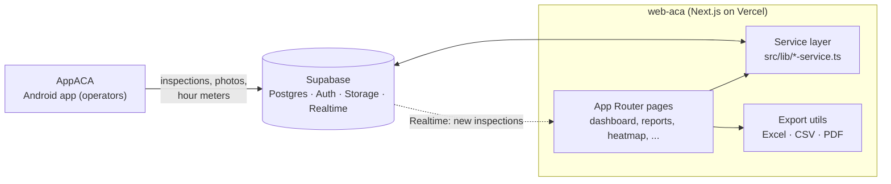
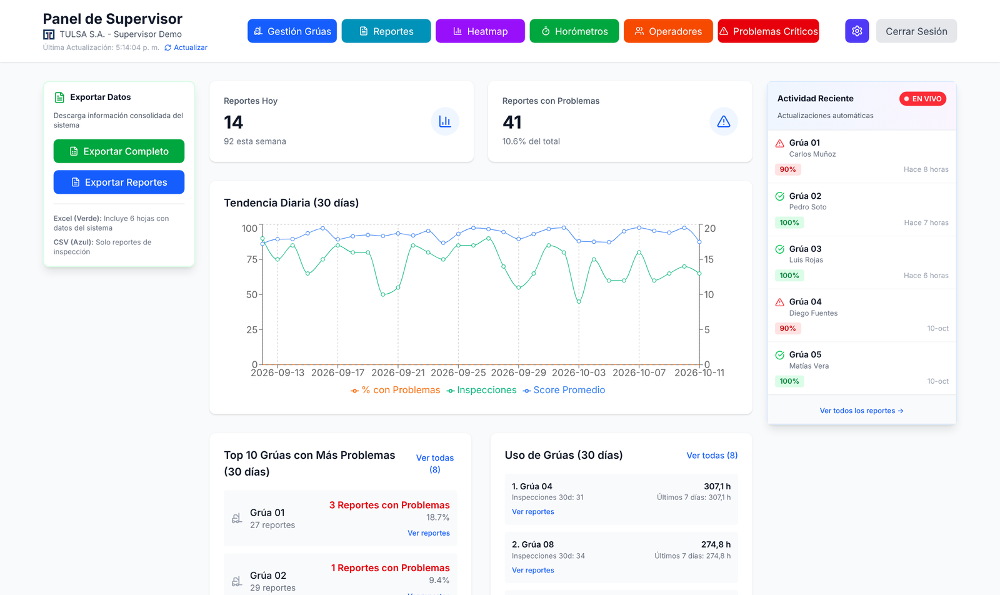
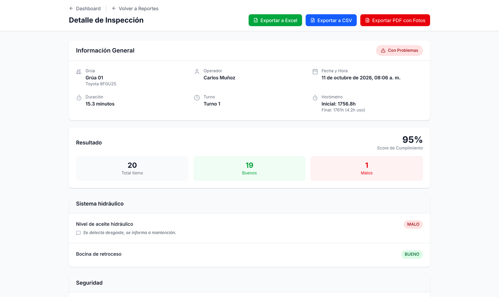
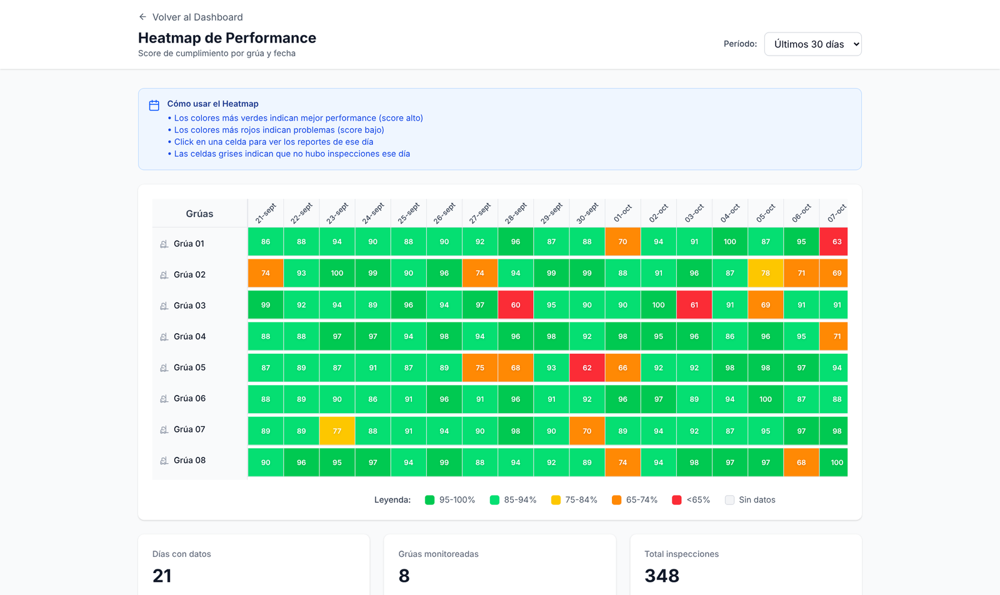
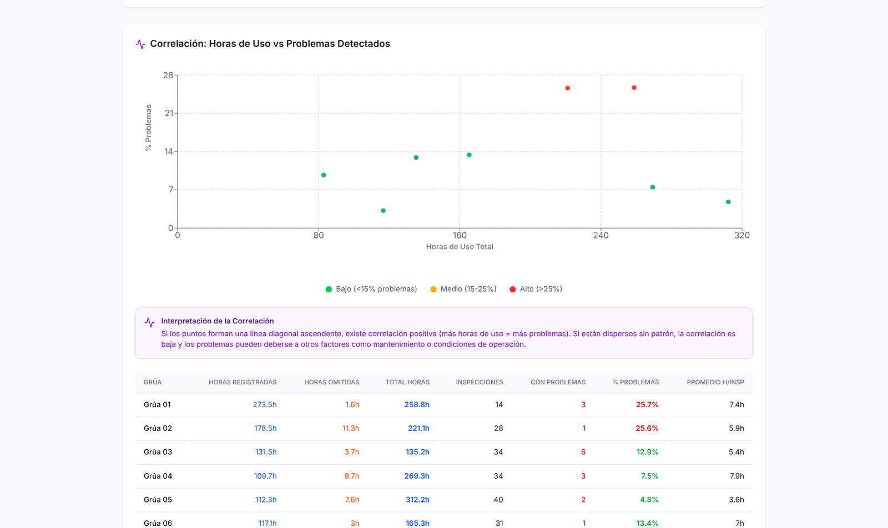
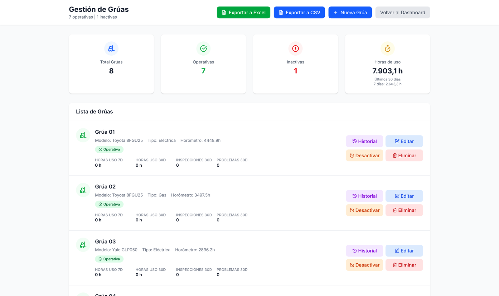

# web-aca: Real-time supervisor dashboard for forklift inspections

Web dashboard for supervisors at **TULSA S.A.** to monitor, analyze and export forklift inspection data captured by the [AppACA Android app](https://github.com/andrynho10/aca). New inspections appear live through Supabase Realtime, and the data is turned into KPIs, rankings, a failure heatmap and usage analytics.

> Built during my professional internship (Sep–Nov 2025) as the **sole developer and project lead** of the inspection platform. Deployed on Vercel as a pilot; it did not reach production.

## Problem

Once inspections were digitized in the mobile app, supervisors needed one place to see what was happening on the floor: which forklifts fail most, which checklist items keep failing, how each shift performs, and how many hours each machine is used. They also needed to share that information as Excel or PDF files.

## Solution

A Next.js dashboard restricted to the Supervisor role that reads from the same Supabase backend as the mobile app. It combines live updates for incoming inspections with analytical views over the last 30–90 days, and exports any view to Excel, CSV or PDF.

## Key features

- **Live dashboard:** KPIs for the day, a 30-day trend of compliance score and failure rate, and a live feed of the latest inspections via Supabase Realtime.
- **Rankings and shift analysis:** most problematic forklifts, most-used forklifts (7 and 30 days), most frequently failed checklist items, and performance by shift.
- **Failure heatmap:** failures per forklift over time to spot high-risk assets.
- **Report explorer:** filters by date range, forklift, operator, shift and failures only; detail view with answers, comments, photo gallery and hour-meter data.
- **Hour-meter analytics:** correlation between usage hours and failures, and completion rate of hour-meter readings per forklift.
- **Operators and critical issues:** dedicated analysis views for operator activity and critical failures.
- **Asset management:** forklift CRUD, status changes (operational / standby / inactive) and QR code generation for the mobile app.
- **Email recipients:** configure who receives inspection report emails, per forklift.
- **Exports:** multi-sheet Excel workbook, CSV, and per-report PDF.
- **Role-based access:** Supabase Auth login; non-supervisor accounts are signed out and rejected.

## Tech stack

| Layer | Technologies |
|---|---|
| Framework | Next.js 15 (App Router), React 19, TypeScript |
| Styling & UI | Tailwind CSS 4, Lucide icons |
| Data & auth | Supabase JS + `@supabase/ssr` (PostgreSQL, Auth, Storage, Realtime) |
| Charts | Recharts |
| Exports | xlsx, jsPDF, html2canvas |
| Hosting | Vercel |

## Architecture



- **Service layer per domain** (`dashboard`, `reportes`, `activos`, `horometros`, `operadores`, `problemas-criticos`) keeps Supabase queries out of the UI components.
- **One backend, two clients:** the dashboard and the mobile app share the same data model, so there is no extra API to maintain.
- **Realtime + polling:** a Realtime subscription pushes new inspections to the live feed, and KPIs refresh periodically.

## Screenshots

*Rendered with demo data (the original Supabase backend was decommissioned).*



| Report detail | Failure heatmap |
|---|---|
|  |  |

| Hour meters vs. failures | Forklift management |
|---|---|
|  |  |

## How to run

**Requirements:** Node.js 18.18+ (20 LTS recommended) and a Supabase project.

```bash
git clone https://github.com/andrynho10/web-aca.git
cd web-aca
npm install
```

Create `.env.local` in the project root (never commit it):

```bash
NEXT_PUBLIC_SUPABASE_URL=https://YOUR-PROJECT.supabase.co
NEXT_PUBLIC_SUPABASE_ANON_KEY=YOUR_ANON_KEY
```

```bash
npm run dev     # http://localhost:3000
npm run build   # production build
```

> **Note:** the database schema and Edge Functions lived in the original Supabase project, which has since been decommissioned, so the dashboard needs a recreated backend to show data.

## My role

Sole developer and project lead for the whole inspection platform (this dashboard, the [Android app](https://github.com/andrynho10/aca), and the Supabase backend):

- Defined requirements and planned the project.
- Designed the shared data model and the architecture of both clients.
- Built the full dashboard (analytics views, Realtime feed, exports, role-based access), deployed it on Vercel, and documented it.
